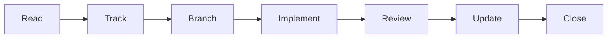

# cc-agents

**trace** is a Claude Code plugin that ties a model's work to the reason for it and to the project's decisions, and blocks it when it drifts.

> [!WARNING]
> Every line of this plugin was written by Claude Code (Opus 5.5). It is tested, but some edge cases may not be covered. Use it at your own discretion.

## Quick start

```
/plugin marketplace add lolisaigao1234/cc-agents
/plugin install trace@cc-agents
```

Then, in each repository you want traced, run `/trace:setup`. Only the human can run it. It checks `gh`, [Matt Pocock's skills](https://github.com/mattpocock/skills) and the triage labels, then opts the repository in through an issue and a PR of its own. The guard and the archive block work everywhere without it.

To switch the trace off for a session, launch Claude Code with `TRACE_BYPASS=1`. Nothing the model can write turns it off.

## How it works

trace doesn't do the work itself. The work goes through Matt Pocock's skills and Claude Code's own tools, and trace adds hooks that refuse whatever leaves the project's records behind. Every change in a traced repository follows one pipeline ([ADR 0006](docs/adr/0006-every-change-is-traced-through-github.md)):



| Part | What it does | Applies | ADR |
| --- | --- | --- | --- |
| **Trace gates** | Refuses an edit unless it is on an open issue's `<n>-` branch, a commit without `#<n>`, and a PR without `Closes #<n>` | Traced repos | [0006](docs/adr/0006-every-change-is-traced-through-github.md) |
| **Forced reads** | Before an agent edits or commits, it must have read, itself and in full, the glossary, every active ADR, the docs the issue names, and the issue | Traced repos | [0007](docs/adr/0007-related-docs-are-forced-reads.md) |
| **Issue in context** | Re-tells the agent the issue after start, resume and compaction, and asks once for a progress comment after a push | Traced repos | [0006](docs/adr/0006-every-change-is-traced-through-github.md) |
| **Band and `/trace`** | Shows the issue, the pipeline step, the docs read and the PR's CI above the prompt; `/trace` prints it in full | Traced repos | [0005](docs/adr/0005-reuse-existing-skills-plugin-is-guardrails-and-visibility.md) |
| **Archive block** | Keeps every agent out of `archive/`, where superseded docs live for the human only | Everywhere | [0008](docs/adr/0008-human-only-archive.md) |
| **Guard** | Refuses commands that destroy work or history (`git reset --hard`, force pushes, `rm -r`, …) and Bash writes to Claude Code's settings | Everywhere | — |

The hooks read command text, so they are a seatbelt against drift, not a sandbox. [plugins/trace/README.md](plugins/trace/README.md) has the exact rules for each part.

## Repository layout

```
plugins/trace/        the plugin: hooks, the band, the setup and trace skills
test/                 tests for the hook scripts
docs/adr/             the decisions the plugin enforces
docs/agents/          how agents use the issue tracker, the labels and the domain docs
GLOSSARY.md           the project's vocabulary
archive/              superseded docs, human-only
```

## Developing

```
npm install
npm run check                       # typecheck, tests, plugin and marketplace validation
claude --plugin-dir plugins/trace   # a session with the working copy
```

## References

Built on:

- [Matt Pocock's skills](https://github.com/mattpocock/skills): the skills the work goes through
- [TStack](https://github.com/t3dotgg/tstack)

Background reading:

- [Solving code review at Anthropic](https://claude.dev/blog/solving-code-review-at-anthropic/)
- [Getting started with Claude Code mods](https://claude.dev/blog/getting-started-with-claude-code-mods/)
- [Automating eval design and hill-climbing](https://claude.dev/blog/automating-eval-design-and-hillclimbing/)
- [Getting the most out of Opus 5.5](https://claude.dev/blog/getting-the-most-out-of-opus-5-5/)

## License

[MIT](LICENSE)
